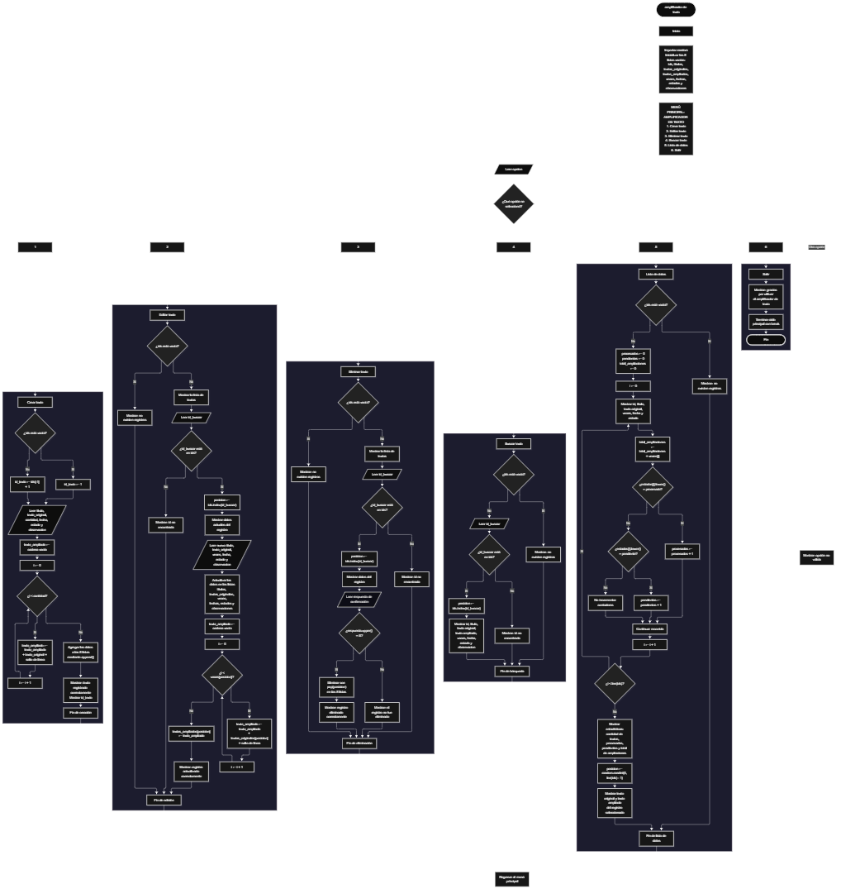

 

Este proyecto, llamado <b>amplificador de texto</b>, fue desarrollado en <b>python</b> como un ejercicio práctico para fortalecer la lógica de programación mediante la creación de un sistema de gestión y ampliación de textos desde la consola. El programa cuenta con un menú principal de seis opciones que permite <b>crear, editar, eliminar, buscar y consultar los datos de los textos registrados</b>, además de generar estadísticas y seleccionar un texto aleatoriamente. Cada registro almacena información como el título, el texto original, el número de repeticiones, el texto ampliado, la fecha, el estado y las observaciones, utilizando ocho listas paralelas durante la ejecución. Para ampliar un texto, el programa utiliza un ciclo repetitivo que concatena el contenido original tantas veces como indique el usuario, agregando un salto de línea en cada repetición. Durante su desarrollo se aplicaron conceptos fundamentales de programación, como variables, listas, estructuras condicionales, ciclos repetitivos, búsqueda de registros, operaciones con listas y selección aleatoria. Este proyecto permite poner en práctica los conocimientos adquiridos en python y sirve como base para desarrollar sistemas de procesamiento y administración de textos más avanzados.

<h2 align="center">⚙️ Funcionamiento del menú principal</h2>

### ➕ Crear texto

La opción <b>1) crear texto</b> permite registrar un nuevo texto y generar automáticamente su versión ampliada. Primero, el programa genera un identificador mediante la lista <b>ids</b>: si no existen registros, asigna el valor <b>1</b>; de lo contrario, utiliza el último identificador almacenado más uno. Después, solicita el <b>título, texto original, cantidad de repeticiones, fecha, estado y observación</b>. Para generar el texto ampliado, inicializa la variable <b>texto_ampliado</b> como una cadena vacía y utiliza un ciclo <b>for</b> que concatena el texto original y un salto de línea tantas veces como indique la variable <b>cantidad</b>. Finalmente, almacena los datos en las ocho listas paralelas y muestra los mensajes <b>"texto registrado correctamente."</b> e <b>"id:"</b>, seguidos del identificador asignado. Actualmente, el programa no comprueba que la cantidad de repeticiones sea positiva ni restringe los valores permitidos para el estado.

### ✏️ Editar texto

La opción <b>2) editar texto</b> permite modificar la información de un registro existente y actualizar su texto ampliado. Primero, el programa comprueba si la lista <b>ids</b> está vacía. Si no existen registros, muestra el mensaje <b>"no existen registros."</b>. En caso contrario, presenta una lista con el identificador, título, texto original, cantidad de repeticiones, fecha, estado y observación de cada registro. Después, solicita el identificador que se desea editar y comprueba si está contenido en <b>ids</b>. Si existe, obtiene su posición mediante <b>ids.index(id_buscar)</b>, muestra los datos actuales y solicita el nuevo título, texto original, número de repeticiones, fecha, estado y observación. A continuación, genera nuevamente el texto ampliado utilizando el contenido actualizado y la nueva cantidad de repeticiones, guardando el resultado en la posición correspondiente de <b>textos_ampliados</b>. Finalmente, muestra el mensaje <b>"registro actualizado correctamente."</b>. Si el identificador no existe, presenta el mensaje <b>"id no encontrada."</b>.

### 🗑️ Eliminar texto

La opción <b>3) eliminar texto</b> permite eliminar un registro de las listas del programa. Antes de comenzar, comprueba si existen datos almacenados. Si la lista <b>ids</b> está vacía, muestra el mensaje <b>"no existen registros."</b>. Si hay registros disponibles, presenta sus datos principales y solicita el identificador del texto que se desea eliminar. Cuando encuentra el identificador, obtiene la posición mediante <b>ids.index(id_buscar)</b> y muestra los datos del registro seleccionado. Después, solicita confirmación mediante la pregunta <b>"¿desea eliminar este registro? (s/n):"</b>. Si la respuesta convertida a mayúsculas mediante <b>upper()</b> es igual a <b>"S"</b>, elimina el elemento de la misma posición en las ocho listas utilizando el método <b>pop(posicion)</b>. Finalmente, muestra el mensaje <b>"registro eliminado correctamente."</b>. Si la respuesta no es <b>"S"</b>, presenta el mensaje <b>"el registro no fue eliminado."</b>. Si el identificador no existe, muestra <b>"id no encontrada."</b>.

### 🔎 Buscar texto

La opción <b>4) buscar texto</b> permite localizar un registro mediante su identificador. Primero, comprueba si existen textos almacenados. Si no hay registros, muestra el mensaje <b>"no existen registros."</b>. En caso contrario, solicita el identificador que se desea buscar y verifica si está presente en la lista <b>ids</b>. Si lo encuentra, obtiene la posición correspondiente y muestra toda la información del registro: <b>id, título, texto original, texto ampliado, cantidad de repeticiones, fecha, estado y observación</b>. Para acceder a los datos utiliza el mismo índice en las listas paralelas. Si el identificador introducido no corresponde a ningún registro, muestra el mensaje <b>"id no encontrada."</b>. Esta opción permite consultar un texto individual sin necesidad de recorrer visualmente todos los datos del programa.

### 📋 Lista de datos

La opción <b>5) lista de datos</b> permite consultar los registros almacenados, obtener estadísticas y visualizar un texto seleccionado aleatoriamente. Primero, comprueba si existen registros. Si la lista <b>ids</b> está vacía, muestra el mensaje <b>"no existen registros."</b>. De lo contrario, inicializa las variables <b>procesados</b>, <b>pendientes</b> y <b>total_ampliaciones</b> en cero. Después, utiliza un ciclo <b>for</b> para recorrer los registros y mostrar el identificador, título, texto original, cantidad de repeticiones, fecha y estado. Durante el recorrido, acumula los valores de <b>veces</b> en <b>total_ampliaciones</b> y cuenta los estados reconocidos como <b>"procesado"</b> y <b>"pendiente"</b>, utilizando <b>lower()</b> para comparar el texto sin distinguir entre mayúsculas y minúsculas. Al finalizar, muestra la cantidad de textos, los procesados, los pendientes y el total de ampliaciones contabilizadas. Finalmente, utiliza <b>random.randint(0, len(ids) - 1)</b> para seleccionar una posición aleatoria y mostrar el texto original y su versión ampliada. Esta selección solo consulta los datos existentes y no modifica los registros.

### 🚪 Salir del menú principal

La opción <b>6) salir</b> permite finalizar la ejecución del programa. Cuando el usuario selecciona esta opción, el programa muestra el mensaje <b>"gracias por utilizar el amplificador de texto."</b> y ejecuta la instrucción <b>break</b> para terminar el ciclo principal <b>while True</b>. De esta manera, el usuario puede crear, editar, eliminar, buscar y consultar textos mientras el programa permanece activo. Los datos se almacenan en listas durante la ejecución, por lo que no se conservan automáticamente después de cerrar el programa.

<h2 align="center">🧠 Temas aplicados en el proyecto</h2>

### 📦 Variables

En este proyecto se utilizan variables para almacenar temporalmente los datos introducidos por el usuario, generar los identificadores, controlar las repeticiones del texto, localizar los registros, confirmar las eliminaciones y calcular las estadísticas. Cada variable cumple una función específica dentro de las operaciones del menú principal y permite coordinar los procesos de creación, edición, eliminación, búsqueda y consulta.

🔢 **Opcion:** Almacena la opción introducida por el usuario en el menú principal.

🆔 **Id_texto:** Almacena el identificador que se asigna al nuevo registro.

📝 **Titulo:** Guarda el título introducido para el texto.

📄 **Texto_original:** Almacena el contenido que se utilizará para generar la ampliación.

🔁 **Cantidad:** Indica el número de veces que se repetirá el texto al crear un registro.

🔄 **Texto_ampliado:** Acumula las repeticiones del texto original, incluyendo los saltos de línea.

📍 **Id_buscar:** Almacena el identificador que se desea localizar durante la edición, eliminación o búsqueda.

🔎 **Posicion:** Indica el índice donde se encuentra el registro seleccionado en las listas.

✅ **Respuesta:** Almacena la confirmación introducida por el usuario antes de eliminar un registro.

📊 **Procesados:** Cuenta los registros cuyo estado corresponde a <b>"procesado"</b>.

⏳ **Pendientes:** Cuenta los registros cuyo estado corresponde a <b>"pendiente"</b>.

🔢 **Total_ampliaciones:** Acumula las cantidades registradas en la lista <b>veces</b>.

🎲 **I:** Funciona como variable de control en los ciclos utilizados para repetir y recorrer los datos.

### 🗃️ Listas

En este proyecto se utilizan ocho listas paralelas para organizar la información de cada texto. Todas mantienen una correspondencia por posición, de modo que los datos almacenados en el mismo índice pertenecen al mismo registro. Por ejemplo, el identificador situado en <b>ids[0]</b> corresponde al título de <b>titulos[0]</b>, al texto original de <b>textos_originales[0]</b> y a los demás datos guardados en esa posición. Esta estructura permite registrar, consultar, actualizar y eliminar la información manteniendo relacionados sus campos. Las listas se crean vacías al iniciar el programa y conservan los datos únicamente durante su ejecución.

🆔 **Ids:** Almacena los identificadores de los textos registrados.

📝 **Titulos:** Guarda los títulos de los registros.

📄 **Textos_originales:** Contiene los textos introducidos por el usuario.

📃 **Textos_ampliados:** Almacena las versiones generadas mediante la repetición del contenido original.

🔁 **Veces:** Guarda el número de repeticiones indicado para cada texto.

📅 **Fechas:** Almacena las fechas asociadas a los registros.

📌 **Estados:** Guarda el estado introducido para cada texto.

💬 **Observaciones:** Contiene las observaciones adicionales de cada registro.

### 🔀 Estructuras condicionales

En este proyecto se utilizan las estructuras <b>if</b>, <b>elif</b> y <b>else</b> para controlar las opciones del menú y decidir qué instrucciones ejecutar. También permiten comprobar si las listas contienen registros, verificar si un identificador existe, determinar si debe realizarse una eliminación y contar los textos cuyo estado coincide con <b>"procesado"</b> o <b>"pendiente"</b>. Estas condiciones permiten responder de manera diferente según los datos almacenados y las decisiones del usuario.

### 🔄 Estructuras repetitivas

El programa utiliza el ciclo <b>while True</b> para mantener activo el menú principal hasta que el usuario selecciona la opción de salida y se ejecuta <b>break</b>. También utiliza ciclos <b>for</b> para recorrer los registros durante la edición, eliminación, búsqueda y listado de datos. Además, el ciclo <b>for</b> que se ejecuta con la variable <b>cantidad</b> permite repetir el texto original tantas veces como indique el usuario. Estas estructuras reducen la necesidad de escribir instrucciones repetidas y permiten procesar los registros de forma organizada.

### 🎯 Selección de opciones del menú

El programa utiliza una cadena de condiciones <b>if</b> y <b>elif</b> para comprobar el valor almacenado en la variable <b>opcion</b> y ejecutar la operación correspondiente. Cada condición representa una de las seis opciones disponibles: <b>crear texto, editar texto, eliminar texto, buscar texto, lista de datos y salir</b>. La estructura <b>else</b> se utiliza para mostrar el mensaje <b>"opción no válida."</b> cuando el usuario introduce un valor que no coincide con ninguna de las opciones definidas.

### 🔎 Búsqueda de registros

La búsqueda de registros se realiza mediante el operador <b>in</b> y el método <b>index()</b>. Primero, el programa comprueba si el identificador introducido está presente en la lista <b>ids</b>. Si existe, utiliza <b>ids.index(id_buscar)</b> para obtener su posición. Ese índice permite acceder a los datos relacionados en las demás listas paralelas. Esta técnica se aplica en las opciones de edición, eliminación y búsqueda, evitando tener que recorrer manualmente los identificadores para localizar el registro seleccionado.

### 🔤 Concatenación de cadenas

La concatenación de cadenas se utiliza para construir el texto ampliado a partir del contenido original. El programa inicia la variable <b>texto_ampliado</b> como una cadena vacía y, dentro de un ciclo <b>for</b>, agrega el texto original seguido de <b>"\n"</b> en cada repetición. El resultado se almacena en la lista <b>textos_ampliados</b>. Cuando se edita un registro, el mismo procedimiento se ejecuta nuevamente para que el texto ampliado corresponda al contenido y al número de repeticiones actualizados.

### 🧰 Métodos y funciones integradas

El programa utiliza distintos métodos y funciones de Python para administrar los datos. El método <b>append()</b> agrega información al final de las listas, mientras que <b>pop()</b> elimina un elemento de la posición indicada. El método <b>index()</b> permite localizar la posición de un identificador y <b>len()</b> obtiene la cantidad de elementos de una lista. También se emplean <b>upper()</b> y <b>lower()</b> para normalizar cadenas durante las comparaciones, <b>int()</b> para convertir las entradas numéricas y <b>random.randint()</b> para seleccionar una posición aleatoria entre los registros disponibles.

### 🎲 Selección aleatoria

La selección aleatoria se realiza mediante la biblioteca <b>random</b>, importada al comienzo del programa. En la opción de lista de datos, la función <b>random.randint(0, len(ids) - 1)</b> genera un índice aleatorio válido entre la primera y la última posición de las listas. A partir de esa posición, el programa muestra el texto original y el texto ampliado del registro seleccionado. Esta operación se ejecuta únicamente cuando existen registros, debido a la comprobación previa de la lista <b>ids</b>. La selección no altera la información almacenada ni cambia el estado del texto.

<h2 align="center">¿Cómo se implementaron las operaciones crud en el proyecto?</h2>

Las operaciones <b>crud</b> se implementaron mediante las opciones del menú principal para administrar los textos registrados. La operación <b>crear</b> corresponde a <b>crear texto</b>, donde se solicitan los datos y se genera el contenido ampliado; <b>leer</b> se realiza mediante <b>buscar texto</b> y <b>lista de datos</b>, que permiten consultar los registros y sus estadísticas; <b>actualizar</b> corresponde a <b>editar texto</b>, donde se modifican los datos y se genera nuevamente la ampliación; y <b>eliminar</b> se realiza mediante <b>eliminar texto</b>, que solicita confirmación y quita el registro de las ocho listas. Todas estas operaciones se ejecutan sobre información almacenada temporalmente en memoria, sin utilizar una base de datos ni archivos para guardar los registros de manera permanente.

<h2 align="center">Diagrama de flujo del proyecto</h2>

<h2 align="center">🛡️ Validaciones del programa</h2>

### 📭 No existen registros

Esta comprobación se utiliza en las opciones de <b>editar texto, eliminar texto, buscar texto y lista de datos</b>. El programa verifica si la lista <b>ids</b> está vacía mediante la condición <b>len(ids) == 0</b>. Si no existen registros, muestra el mensaje <b>"no existen registros."</b> y evita continuar con las operaciones que necesitan información almacenada. Esta comprobación también garantiza que la selección aleatoria se ejecute únicamente cuando existe al menos un texto registrado.

### 🔎 Identificador no encontrado

Esta comprobación se utiliza cuando el usuario intenta editar, eliminar o buscar un texto mediante su identificador. El programa verifica si el valor introducido está presente en la lista <b>ids</b>. Si lo encuentra, obtiene la posición correspondiente mediante <b>index()</b> y continúa con la operación solicitada. Si no existe, muestra el mensaje <b>"id no encontrada."</b>. De esta manera, evita acceder a una posición a partir de un identificador que no se encuentra registrado.

### 🗑️ Confirmación de eliminación

Antes de eliminar un registro, el programa muestra sus datos y solicita confirmación mediante la pregunta <b>"¿desea eliminar este registro? (s/n):"</b>. La respuesta se convierte a mayúsculas utilizando <b>upper()</b>. Si el resultado es igual a <b>"S"</b>, se elimina el registro de las ocho listas. Cualquier otra respuesta evita la eliminación y muestra el mensaje <b>"el registro no fue eliminado."</b>. Esta comprobación permite que el usuario confirme la operación antes de quitar los datos.

### ⚠️ Opción no válida

El bloque <b>else</b> del menú principal se ejecuta cuando el valor introducido en <b>opcion</b> no coincide con las opciones del <b>1</b> al <b>6</b>. En ese caso, el programa muestra el mensaje <b>"opción no válida."</b> y vuelve a presentar el menú en la siguiente iteración del ciclo <b>while True</b>. Esto permite continuar utilizando el programa después de introducir una opción incorrecta.

### 🔢 Conversión de entradas numéricas

El programa utiliza <b>int()</b> para convertir a números enteros el identificador introducido durante la edición, eliminación y búsqueda, así como la cantidad de repeticiones al crear o editar un texto. Sin embargo, actualmente no incluye un mecanismo para controlar los errores de conversión. Si el usuario introduce un valor que no puede convertirse a entero, el programa puede finalizar con una excepción. Por tanto, existe conversión de entradas numéricas, pero todavía no hay una validación que gestione las entradas incorrectas.

### 🔁 Cantidad de repeticiones

La cantidad de repeticiones se convierte a entero mediante <b>int()</b> y se utiliza como límite del ciclo <b>for</b> que genera el texto ampliado. El código no comprueba que este valor sea mayor que cero. Si se introduce cero o un número negativo, el ciclo no agrega contenido y el texto ampliado queda vacío. Tampoco se establece un límite máximo para la cantidad de repeticiones, por lo que el tamaño del resultado depende del valor introducido por el usuario.

### 📌 Estados de los textos

Al crear un registro, el programa solicita un estado mediante el mensaje <b>"estado (procesado o pendiente):"</b>. No obstante, no comprueba que el valor introducido corresponda a uno de esos dos estados. Durante las estadísticas, solo se cuentan los registros cuyo estado coincide con <b>"procesado"</b> o <b>"pendiente"</b>, después de convertirlo a minúsculas mediante <b>lower()</b>. Los estados diferentes de esos valores permanecen almacenados, pero no se incluyen en ninguno de los dos contadores.

### 🆔 Generación de identificadores

El identificador de cada nuevo texto se genera comprobando si la lista <b>ids</b> está vacía. Si no existen registros, se asigna el valor <b>1</b>; en caso contrario, se toma el último identificador de la lista y se le suma uno. Este procedimiento funciona con el orden de registro actual, pero no garantiza identificadores únicos en todas las circunstancias: si se elimina el último registro y posteriormente se crea otro, el identificador eliminado podría reutilizarse.

### 💾 Almacenamiento temporal

Los datos se guardan en ocho listas creadas al comienzo del programa. No se utiliza una base de datos ni se implementan archivos para guardar la información de forma permanente. Por ello, los registros permanecen disponibles mientras el programa está en ejecución, pero se pierden cuando finaliza. Esta característica corresponde al funcionamiento actual del proyecto y no representa una operación de almacenamiento permanente.

<h2 align="center">🎯 Objetivo del proyecto</h2>

El objetivo principal de este proyecto es fortalecer la <b>lógica de programación</b> mediante el desarrollo de un sistema de gestión y ampliación de textos en <b>python</b>. A través de su construcción se busca aplicar conocimientos sobre variables, listas, estructuras condicionales, ciclos repetitivos, manejo de cadenas, búsqueda de registros y funciones integradas. El proyecto permite comprender cómo generar contenido mediante repeticiones, mantener relacionados varios datos de un mismo registro y realizar operaciones para crear, consultar, actualizar y eliminar información. Además, incorpora estadísticas y selección aleatoria como ejercicios prácticos para el procesamiento de datos, estableciendo una base para desarrollar aplicaciones de texto más completas.

